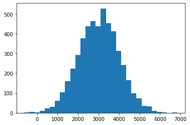
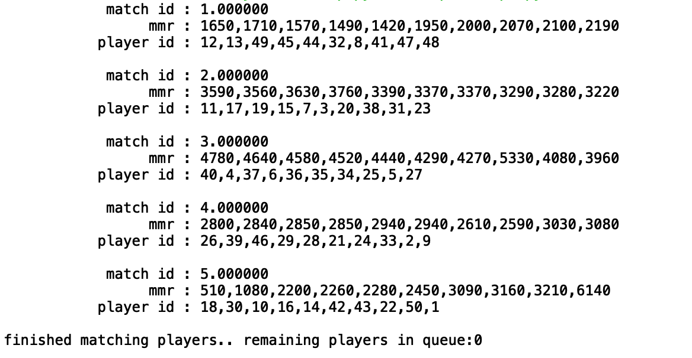

A quick implementation of matchmaking for dota 2.

This repo now supports two matchmaking algorithms.

## Algorithms

### `anchor-nearest`

This is the original idea:

1. Randomly choose one anchor player.
2. Pull the 9 closest MMR neighbors.
3. Split the 10 selected players into two sequential 5-player teams.

This is simple, but it does not optimize team balance.

### `balanced-window`

This is the alternate algorithm added on this branch:

1. Sort the queue by MMR.
2. Evaluate every contiguous 10-player window.
3. Pick the best window based on narrow queue spread and player waiting time.
4. Split the 10 selected players into two balanced 5-player teams by minimizing the total team MMR gap.

This changes the objective from "close players around one anchor" to "best lobby in queue plus fairest team split."

 Players mmr assumed to be normally distributed, with mean 3k and variance 1k.

## Run

```bash
python3 simplescript.py --players 50 --algorithm balanced-window
python3 simplescript.py --players 50 --algorithm anchor-nearest
```

## Tests

```bash
python3 -m unittest discover -s tests
```

 



